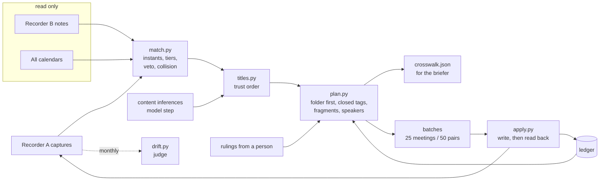

# meeting-crosswalk

An agent lane that reconciles two meeting recorders and the calendars into one crosswalk, then writes corrections back into the recorder: titles, one folder per meeting, a closed tag set and speaker names, with a monthly drift judge.

Unofficial. In my setup the two recorders were Granola and Krisp. This repo is not affiliated with either, and the code talks to adapter interfaces, not to any product API.

## The problem

I record most meetings with two tools. Recorder A transcribes everything but only sees my primary calendar, so it names a capture after whatever block sits there at that hour: "Focus Time" for a partner meeting, a clock time for a hiring loop debrief. Recorder B sees every calendar but only labels a note when I link it, so ad hoc notes carry wrong titles too. I built this because a library of 1,152 meetings had 74% of them flagged as mislabeled, 101 captures of a minute or more in no folder or in two, and 209 meetings with tag names I had stopped using. Fixing it by hand was not going to happen, and an agent that writes to my recorder unattended needs rules a reviewer can check.

## Consent

Recording and transcribing a meeting means telling the people in it and following the consent laws where you and they are; some places require everyone's agreement. This tool does not record anything. It only reorganizes captures you are already allowed to keep: titles, folders, tags and speaker labels.

## How it works



1. **Match.** Each capture is scored against recorder B notes and calendar events by start time (as an absolute instant, offsets included, timezone labels ignored), participants, duration and shared content words. Result: HIGH, MEDIUM, LOW or UNMATCHED. Calendar blocks are never candidates. A capture with several voices never matches a solo note (the veto). If the top two meetings tie at the same hour, it is a time collision: LOW, nothing written.
2. **Title.** A title the user set by hand stays. Then a calendar event with a linked note whose title agrees with the content, then a title inferred from the transcript, then the event title. An unlinked note's title is never used.
3. **Plan.** The folder is the stream truth. Tags come from a closed vocabulary: the six folder names plus `mislabeled`, `needs-review` and `fragment`. Retired tag names go. Fragments (under 60 s, or an auto title under 5 min with no notes) are tagged and listed for deletion. Speaker labels are fixed only from the meeting's own roster. The planner writes nothing; it emits ops.
4. **Apply.** Ops go out in batches of at most 25 meetings and 50 (meeting, tag) pairs. Folder removals wait for approval. Success is decided by reading the recorder back; only verified writes enter the ledger, and the ledger stops the next run from repeating them.
5. **Judge.** Once a month, `drift.py` reads the recorder's state and prints one line against fixed targets.

The model does one job: reading a transcript to infer a title and stream when no calendar event or linked note can be trusted. That output enters the planner as data, with a count of agreeing signals. Everything else is deterministic Python. The lane prompt that ties it together is [skills/meeting-reconciliation/SKILL.md](skills/meeting-reconciliation/SKILL.md); its consumer is [skills/meeting-briefer/SKILL.md](skills/meeting-briefer/SKILL.md).

## Quickstart

Python 3.9 or newer, standard library only, no network.

```sh
git clone https://github.com/gkmr/meeting-crosswalk && cd meeting-crosswalk
python3 -m unittest discover -s tests                # 63 tests
python3 -m crosswalk demo                            # full cycle on the fake recorder
python3 -m crosswalk demo --approve-removals         # same, as an operator who approves folder removals
python3 -m crosswalk plan examples/library.json \
    --inferences examples/inferences.json --rulings examples/rulings.json --out out
python3 -m crosswalk drift examples/library.json
```

When the batches go out through a real connector instead of the fake, `python3 -m crosswalk verify out/plan.json after.json --ledger ledger.json` checks a fresh read of the recorder against the plan and records only the confirmed writes.

Full output of `python3 -m crosswalk demo` on the 40-capture fixture:

```
before  drift | not-one-folder 21 (captures >= 60 s) | multi-stream 2 | mislabeled 5 (12%) | needs-review 2 (5%) | fragment 0 | retired-tag 4 | library 40 | filed 18
plan    40 captures | HIGH 12 MEDIUM 6 LOW 5 UNMATCHED 17
        ops: file 14, detach 12, attach 21, rename 11, speaker 6 | gated 1 | skipped by ledger 0
        26 recorder calls, largest carries 21 pairs
        review cap-03  fragment             tag only; delete by hand
        review cap-04  fragment             tag only; delete by hand
        review cap-08  time collision       evt-08b vs evt-08a
        review cap-10  two folders          remove from Personal once approved
        review cap-13  fragment             tag only; delete by hand
        review cap-14  stream unknown       MEDIUM; stream tags: none
        review cap-22  stream unknown       UNMATCHED; stream tags: none
        review cap-23  stream unknown       LOW; stream tags: none
        review cap-32  fragment             tag only; delete by hand
apply: ok | verified writes: attach 21, detach 12, file 14, rename 11, speaker 6 | calls 25 | skipped 0 | gated 1 | blocked 0 | errors 0 | unverified 0
after   drift | not-one-folder 5 (captures >= 60 s) | multi-stream 0 | mislabeled 3 (8%) | needs-review 1 (2%) | fragment 4 | retired-tag 0 | library 40 | filed 32
        targets missed: not-one-folder 5 > 0
re-plan 0 auto ops, 1 gated
parity  recorder A folder agrees with recorder B folder on 10 of 11 matched meetings (miss: cap-10)
```

The 5 left are left on purpose: a time collision, a capture in two folders waiting for approval, a MEDIUM match with no stream, a LOW match and one with no evidence at all. `plan` also lists each of them for a person.

## How it is verified

- **Unit tests (63).** The planner fixes every planted case in [examples/](examples/README.md): block titles renamed and filed, a two-folder capture gated, fragments tagged and never filed, retired tags removed, MEDIUM filed or marked, the time collision not filed even though it carries an old stream tag. Drift numbers before and after are asserted exactly. A second run produces zero ops, both from a fresh read and from a stale snapshot plus the ledger. I checked the tests bite by breaking the code on purpose: no veto fails 5 tests, no collision rule fails 8, a ledger that never matches fails 5, letting LOW rows be written fails 5, trusting the call count instead of the read-back fails 1.
- **Read-back verification.** `apply.py` counts a write only after a fresh read of the recorder shows it. A fake recorder that accepts writes and drops them yields `partial` and the next run retries.
- **Drift judge.** One line per month against fixed targets: not-one-folder 0, multi-stream 0, mislabeled under 10%, needs-review under 5%, retired tags 0, fragments listed.
- **Backtest on a real library.** On 2026-11-02 the planner ran against my 1,152-meeting library: mislabeled 853 (74%) to 105 (9%), not in exactly one folder 101 to 19, needs-review 719 to 1, multi-stream 52 to 0, retired tags 209 to 0, with 1,689 tag removals and 141 additions and zero failed writes. Two outside judges checked it: folder parity against the second recorder held on 37 of 40 October meetings (the 3 misses were time collisions, which is why the collision rule exists), and an independent re-read caught 1 misfile the planner made. Details and what each number measures: [docs/backtest.md](docs/backtest.md).

## Design decisions and tradeoffs

- **Folders, not tags, are the stream truth.** See the next section.
- **LOW is never written, and a collision blocks even the old tag.** A capture's existing stream tag usually came from an earlier match. When two meetings share the hour, that earlier match was probably the same coin flip, so the planner lists the capture for a person instead of trusting it. Cost: a few review items. Benefit: the failure behind the 3 backtest misses becomes a review item instead of a misfile.
- **The lane's own writes are never evidence.** The recorder title is excluded from content matching (it is either a block or something the lane wrote), and speaker names the lane wrote are put back to their original labels before matching, using the ledger. Without this, a MEDIUM match promotes itself to HIGH on the next run.
- **Pure planner, verifying executor.** The planner returns ops and never touches a recorder, so a plan can be reviewed as JSON before anything happens. The executor trusts a read-back, not its own call count.
- **The write fence is structural.** The recorder B and calendar adapters have no write methods. Folder removals carry an approval gate. New tag names are not created unattended, and when allowed, each is created by one serial call first, because two parallel first-attaches of a new name can create two tags with the same name.
- **One model step, entered as data.** Content inference produces a title, a stream and a signal count. One signal is MEDIUM, two agreeing signals are HIGH. Text inside transcripts and notes is treated as data, never as instructions.

## Why folders, not tags

The first version used a stream tag per meeting as the source of truth. It drifted in three ways:

1. **A tag set has no "exactly one".** Nothing stopped a meeting from carrying two stream tags. The backtest found 52 of them. A folder per meeting makes the rule visible: zero or two folders is a count on the drift line.
2. **Tag names drift.** Four old names (the equivalents of "Recruiting" and "Mentorship" here) still sat on 209 meetings. Folder names are created once and are the same in both recorders, so they double as the closed vocabulary.
3. **Folders give an outside judge.** Recorder B files notes in folders with the same names. Comparing folder to folder for the same meeting is a check the planner cannot grade itself on: 37 of 40 in October.

Tags still have a job. The stream tag mirrors the folder so search works, and the three markers are states rather than streams: `mislabeled` (title is still a block), `needs-review` (MEDIUM, not filed), `fragment` (delete by hand). The tradeoff: a meeting that truly belongs to two streams cannot be expressed. The lane lists those for a person instead of picking one.

## Limitations

- Matching is rules with hand-set weights, tuned on one library (mine). Another person's calendar habits may need different thresholds; they live in [crosswalk/config.py](crosswalk/config.py).
- The content inference step lives in the skill, not in this package. The planner trusts whatever inference file it is given.
- No real connector code ships. Adapters are interfaces plus an in-memory fake; real recorder APIs change and need auth.
- One writer is assumed. Two lanes writing the same recorder would race.
- The recorder in my setup had no delete, so fragments are only tagged and listed.
- Speaker fixes are conservative: two placeholders against two unnamed roster members stay unresolved.
- The real-library numbers are one backtest, one person, one month of parity checks. The fixture is 40 invented captures.

## Layout

```
meeting-crosswalk/
├── crosswalk/            python package (stdlib only)
│   ├── match.py          instants, scoring, tiers, veto, collision
│   ├── titles.py         generic title regex, trust order
│   ├── speakers.py       roster-only speaker fixes
│   ├── plan.py           folder-first planner, ops, batches
│   ├── apply.py          executor with read-back verification
│   ├── ledger.py         idempotency slots
│   ├── drift.py          drift metrics, targets, parity judge
│   ├── config.py         vocabulary and limits
│   ├── model.py          records and JSON loaders
│   └── __main__.py       demo, plan, verify, drift commands
├── adapters/             interfaces and the in-memory fake (README.md)
├── skills/
│   ├── meeting-reconciliation/SKILL.md   the lane prompt
│   └── meeting-briefer/SKILL.md          the consumer
├── examples/             synthetic library, inferences, rulings (README.md)
├── tests/                unittest suite
├── docs/backtest.md      real aggregate numbers and the two outside judges
├── CHANGELOG.md
└── LICENSE
```

MIT license. Copyright (c) 2026 Ganesh Kumar.
